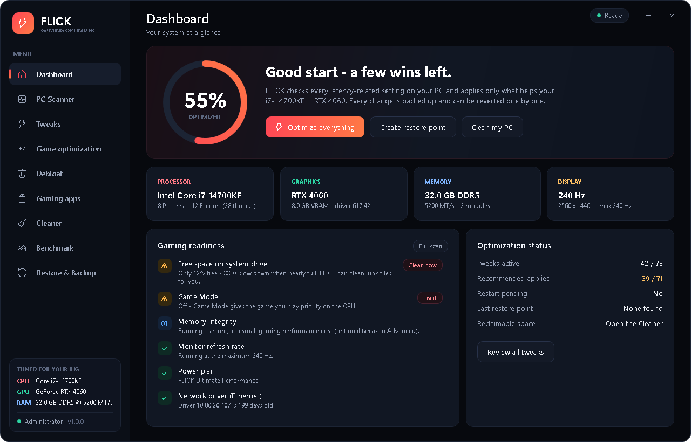
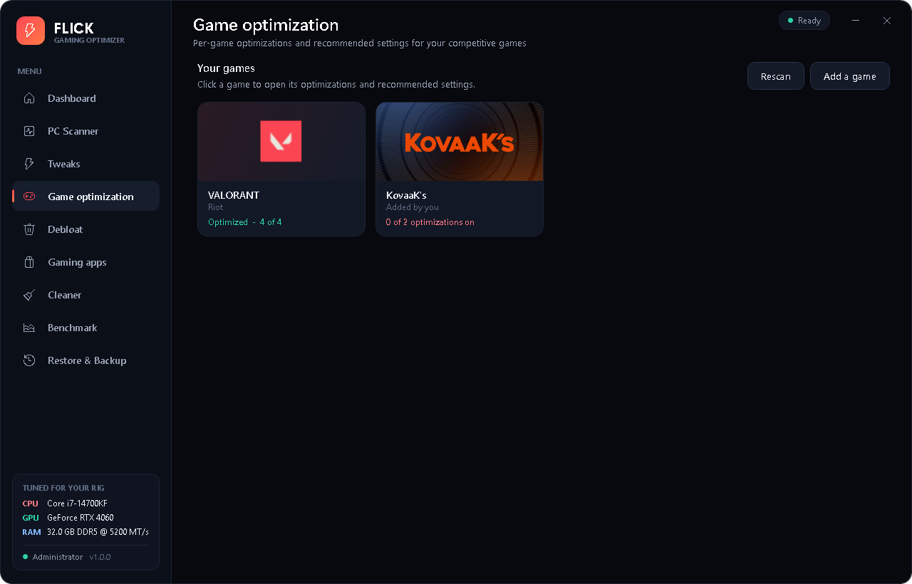
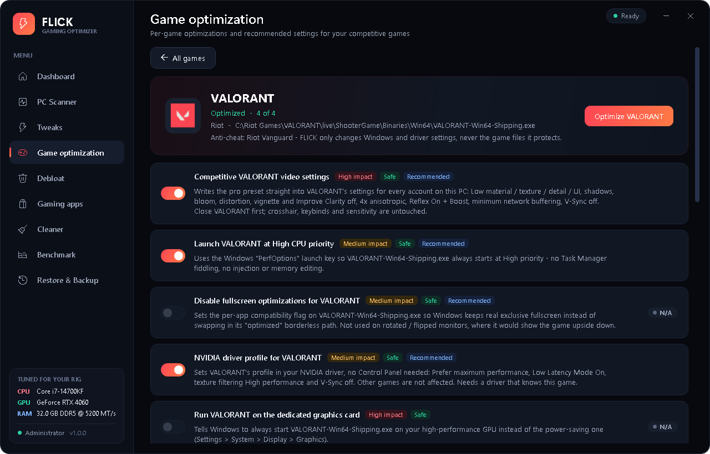
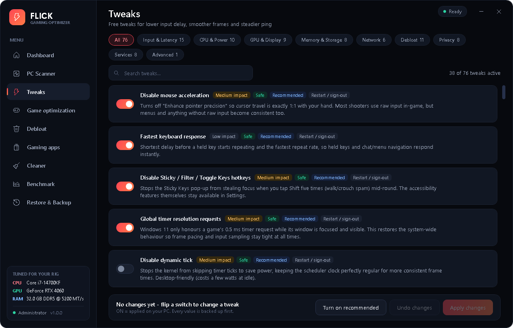
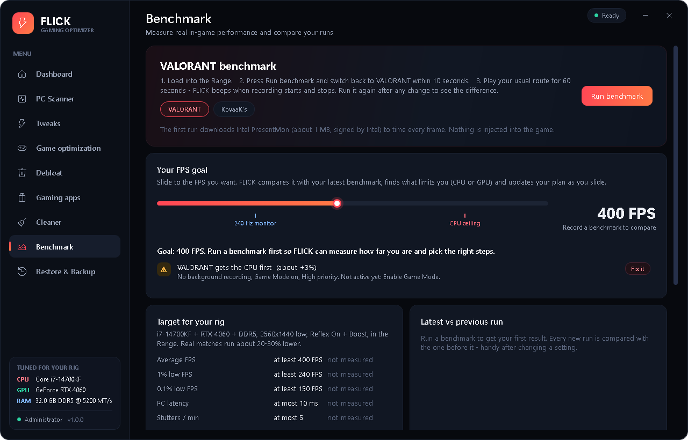
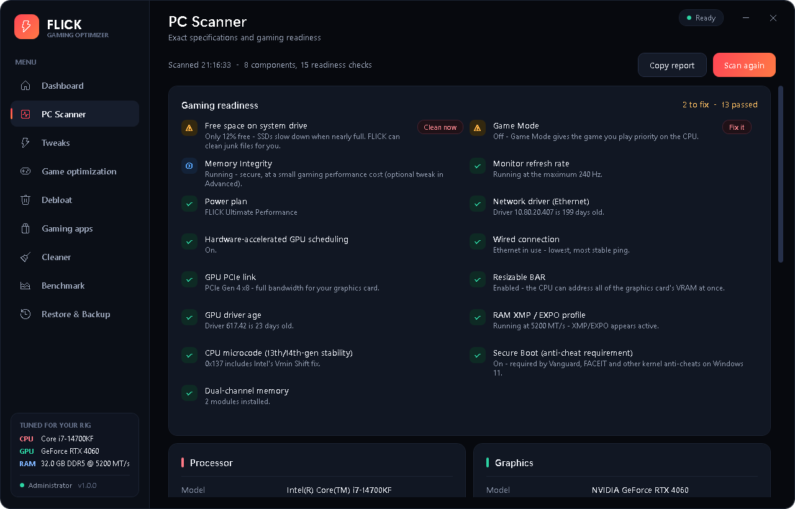
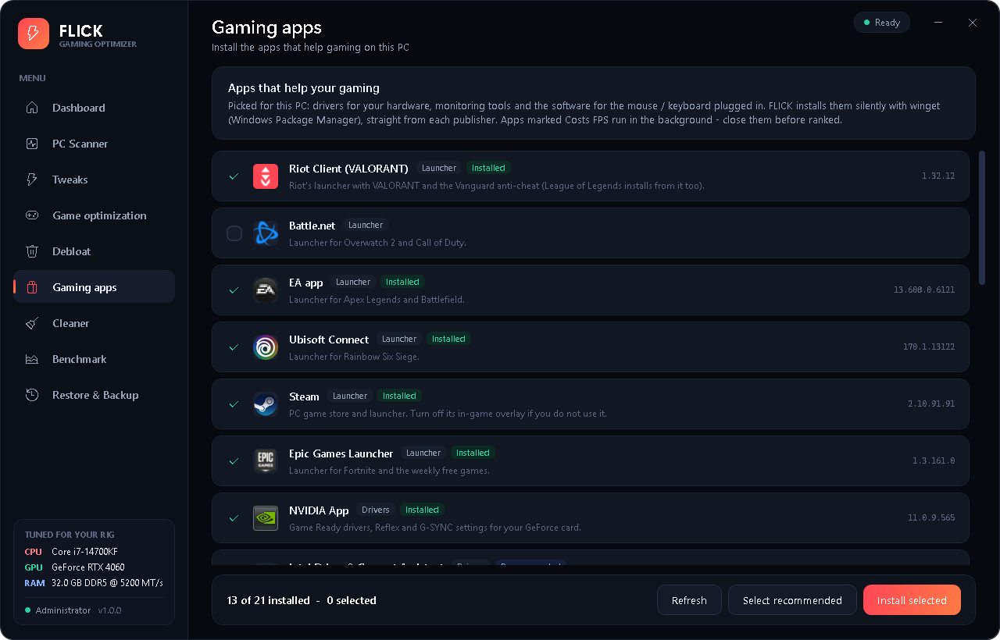

  

# FLICK Optimizer

**A free Windows optimizer for competitive games.** Lower input lag, steadier FPS and a lighter
Windows - tuned automatically for *your* hardware and *your* games, with every change backed up
and reversible.

[**Download the latest version**](https://github.com/flickoptimizer/flick-optimizer/releases/latest) ·
[Changelog](CHANGELOG.md) · [Discord](#community)

---

## What it does

- **Game optimization** - finds the competitive games installed on your PC (VALORANT, Counter-Strike 2,
  Fortnite, Apex Legends, Overwatch 2, League of Legends, Call of Duty, Rainbow Six Siege, Rocket League,
  Marvel Rivals, Dota 2, PUBG, THE FINALS, Deadlock - or any game you add) and gives each one its own
  menu: CPU priority, fullscreen behaviour, NVIDIA driver profile, network priority and recommended
  in-game settings.
- **80+ tweaks** for input latency, CPU scheduling, power, GPU, memory, network and privacy - each with
  a clear description, impact and risk level. Flip a switch, press *Apply changes*.
- **PC scanner** - exact specs and a gaming-readiness checklist (XMP, Resizable BAR, drivers, refresh
  rate, Secure Boot / TPM for anti-cheats...) with one-click fixes.
- **Benchmark** - records real gameplay with Intel PresentMon: average FPS, 1% / 0.1% lows, stutters
  and PC latency, run against run.
- **Debloat & Cleaner** - removes pre-installed apps that run in the background and clears junk files.
- **Gaming apps** - installs the tools that help (drivers, monitoring, your mouse / keyboard software)
  straight from each publisher.

## Screenshots

| | |
|---|---|
|  |  |
|  |  |
|  |  |

## Install

1. Download **FLICK-Setup.exe** from the [latest release](https://github.com/flickoptimizer/flick-optimizer/releases/latest).
2. Windows may show *"Windows protected your PC"*: FLICK is new and not code-signed yet.
   Click **More info**, then **Run anyway**.
3. Accept the administrator prompt - FLICK needs it to change Windows settings.

Uninstall any time from **Settings > Apps > FLICK Optimizer**.

**Requirements:** Windows 10 or 11 (64-bit).

## Safe by design

- Offers a **System Restore point** before applying anything.
- Saves the **original value of every setting** it changes, so each tweak can be reverted on its own -
  or everything at once with *Revert ALL*.
- **Never touches game files**, never injects into games, never disables your antivirus.
- Downloads only from the original publisher (NVIDIA, Windows Update, winget) and checks signatures.

## Community

Questions, bugs and ideas: join the FLICK Discord server *(invite link coming soon)*.

---

FLICK Optimizer is free software, but not open source - see [LICENSE](LICENSE).
